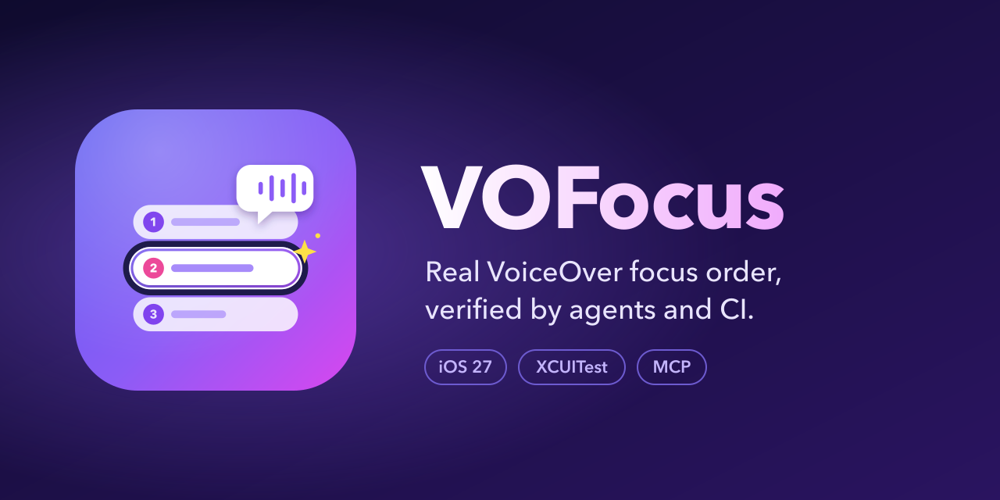

# VOFocus

<p align="center"></p>

Automated verification of **real VoiceOver focus order** on iOS, built for agents and CI.

Checking VoiceOver focus has meant a person swiping through screens on a device. VOFocus
drives VoiceOver itself through `XCUIVoiceOverService`, so an agent or CI job can launch a
screen, trigger an action and verify where VoiceOver goes, including focus the app moves
itself with `.screenChanged`, `.layoutChanged` or `@AccessibilityFocusState`. It can also
change adjustable controls the way a VoiceOver user does, and (experimental) record what
VoiceOver actually says and plays.

A test runner on the iPhone or Simulator drives real VoiceOver, and the CLI or MCP server
on your Mac sends it commands ([diagram](docs/ARCHITECTURE.md)). **Status: early.**

### Why not the Accessibility Inspector or the accessibility tree?

Both walk the accessibility tree. Neither follows programmatic focus, so they can't show
where VoiceOver lands when a sheet, error or banner appears, which is what most often
breaks. VOFocus asks VoiceOver itself.

For static checks (contrast, missing descriptions, hit areas, clipped text), use
[`performAccessibilityAudit`](https://developer.apple.com/documentation/xcuiautomation/xcuiapplication/performaccessibilityaudit(for:_:))
alongside VOFocus.

## Requirements

- macOS with Xcode 27 or later. CI needs macOS runners.
- iOS 27 or later, on a Simulator or device: `XCUIVoiceOverService` doesn't exist
  earlier. Use 27.2 or later, since 27.0 has [bugs](#how-voiceover-behaves-under-automation).
  The Simulator covers most checks; confirm focus checks on a device
  ([why](#simulator-vs-device)). On a device, turn on **Settings → Developer → Enable UI
  Automation** and keep the device unlocked while the runner starts.
- [XcodeGen](https://github.com/yonaskolb/XcodeGen) (`brew install xcodegen`) to build
  from a checkout. An installed VOFocus doesn't need it.

## Install

```sh
brew install marybm-dev/tap/vofocus
```

Or from source:

```sh
git clone https://github.com/marybm-dev/vofocus.git && cd vofocus
scripts/install.sh ~/.local      # vofocus and vofocus-mcp in ~/.local/bin
```

The first time it starts, an installed VOFocus builds the runner (a few minutes) into
`~/Library/Caches/vofocus`. Everything below also works from the checkout, using
`Host/.build/release/` and `build/` instead.

For physical devices, save the Apple developer team that signs the runner (the Simulator
needs nothing):

```sh
vofocus setup --team <your team ID>   # Xcode > Settings > Accounts shows it
vofocus setup                         # shows the current settings and folders
```

## Run checks unattended (CLI)

Write a check as a YAML scenario ([format](scenarios/README.md)), then run it:

```sh
vofocus run scenarios/ --junit report.xml              # Simulator
vofocus run scenarios/ --device <UDID>                 # a device
vofocus record scenarios/new-check.yml --write         # fill in expectations
```

```
FAIL  Static screen reads heading, then One, Two, Three (static-order.yml, 28 s)
    ✓ landing: Static Order Heading
    ✗ walk
        focus order differs (expected 4 stops, VoiceOver made 4):
            1. expected "Static Order Heading", heard "Static Order Heading"
            2. expected "One Button", heard "One Button"
          ✗ 3. expected "Three Button", heard "Two Button"
          ✗ 4. expected "Two Button", heard "Three Button"
```

`vofocus run` starts and stops the runner itself (`--keep-runner` leaves it up), exits 1
if any scenario fails, and writes JUnit XML with `--junit`.

**In CI:** `.github/workflows/voiceover-checks.yml` runs the demo scenarios on a GitHub-hosted
macOS runner's Simulator and uploads the JUnit report. It runs only when started by
hand; uncomment `pull_request` to run it on every pull request. macOS runner minutes
cost more than Linux on private repositories. Any macOS CI with Xcode 27 works the same
way: install XcodeGen, build your app, and run `vofocus run`.

## Use it from an agent (MCP)

`vofocus-mcp` is an MCP server (stdio) that starts the runner and exposes it as tools.

```sh
claude mcp add vofocus -- "$(brew --prefix)/bin/vofocus-mcp"       # Homebrew
claude mcp add vofocus -- ~/.local/bin/vofocus-mcp                 # install.sh
claude mcp add vofocus --env VOFOCUS_ROOT="$PWD" -- "$PWD/Host/.build/release/vofocus-mcp"   # from a checkout
```

| Tool | What it does |
|---|---|
| `runner_start`, `runner_status`, `runner_stop` | Start (or attach to), check and stop the runner; stopping turns VoiceOver off |
| `app_install`, `app_launch` | Install a built `.app` (a Simulator build, or a signed device build); launch an app with VoiceOver on |
| `vo_move`, `vo_walk` | Move VoiceOver one step; get the whole focus order |
| `vo_focus`, `vo_activate` | Move VoiceOver to an element; activate (VoiceOver double tap) |
| `vo_swipe` | VoiceOver's swipe up or down: adjust a slider or other adjustable control, or read the next custom action |
| `vo_speech` | What VoiceOver said, or wait until it says something (programmatic focus) |
| `ui_tree`, `ui_tap`, `ui_type` | The UI as a compact outline; plain XCUI actions |
| `audio_start`, `audio_report` | Experimental: what VoiceOver actually said and played after each call ([below](#hear-what-voiceover-says-experimental)) |

A typical check: `runner_start` → `app_launch` (with launch arguments that open the
screen) → `vo_focus` on the trigger → `vo_activate` → `vo_speech` with `contains` →
`runner_stop`.

**Cleaning up:** the server tells agents to call `runner_stop` when done, and stops a
runner it started when the session ends (the client disconnects, or SIGTERM, SIGINT or
SIGHUP). It leaves alone a runner it didn't start, such as one from `scripts/runner.sh`.

**Settings** (environment): `VOFOCUS_ROOT` (a checkout to use; not needed when
installed), `VOFOCUS_BUILD_DIR` (where the runner is built and its logs and tokens go),
`VOFOCUS_PORT` (8740), `VOFOCUS_SIMULATOR` ("iPhone 18 Pro"), `VOFOCUS_DEVICE` and
`DEVELOPER_DIR`.

**On a device:** set `VOFOCUS_DEVICE` to a connected device's UDID (from
`xcrun devicectl list devices`) or name. The server reaches the runner over the
CoreDevice tunnel, with no port forwarding. To keep both targets available, register a
second server on another port:

```sh
claude mcp add vofocus-device --env VOFOCUS_DEVICE=<UDID> --env VOFOCUS_PORT=8741 \
  -- "$(brew --prefix)/bin/vofocus-mcp"
```

`scripts/mcp_smoke.py` checks the whole flow end to end, on the Simulator or (with
`VOFOCUS_DEVICE`) a device.

## Hear what VoiceOver says (experimental)

The runner reports what VoiceOver *meant* to say. With recording on, VOFocus also
reports what was actually heard at each step: speech that was cut off or never audible,
and VoiceOver's sounds (the boundary "bonk", focus moves, screen changes).

```sh
vofocus run scenarios/ --audio audio/        # per-step report, WAV files, JSON timeline
```

Agents use `audio_start`, then any tools, then `audio_report`. No microphone is
recorded, and speech is transcribed on the Mac. On the Simulator it records only
VoiceOver's processes and needs the macOS system audio permission. On a device (USB) it
records everything the phone plays, so turn on Do Not Disturb; it needs the macOS camera
permission, though no camera is used. See [docs/AUDIO.md](docs/AUDIO.md) for example
output, details and limits.

## The runner

The runner is a single long-running UI test, in the style of WebDriverAgent. It serves
HTTP on port 8740 and drives any installed app by bundle ID, so apps need no test code.
On a Simulator it's at `localhost:8740`; on a device, at the CoreDevice tunnel address
(`http://[<tunnelIPAddress>]:8740`, from `xcrun devicectl device info details --device <UDID>`).

```sh
scripts/runner.sh                    # restarts the Simulator, builds, serves until POST /shutdown
scripts/runner.sh --device <UDID>    # on a connected device; prints the address to use
```

`POST /shutdown` ends the test, turning VoiceOver off. After each build,
`scripts/brand-runner.sh` names the runner app "VOFocus Runner", gives it an icon and
re-signs it; set `VOFOCUS_BRAND=0` to skip this.

The runner listens only on `127.0.0.1` (Simulator) or the CoreDevice tunnel (device),
and only answers requests that carry its token. `runner.sh` makes a new token on every
start and saves it as `runner-<port>.token` (`runner-<port>-<device>.token` for a device)
in the build folder, readable only by you. If another runner already answers on the
port, the CLI and the MCP server say so instead of starting a second one. See
[docs/SECURITY-MODEL.md](docs/SECURITY-MODEL.md).

The CLI and the MCP server read the token for you. With `curl`:

```sh
AUTH="Authorization: Bearer $(cat build/runner-8740.token)"
curl -H "$AUTH" -X POST localhost:8740/session -d '{"bundleId":"com.example.App","arguments":["-VOScenario","uikit-banner"]}'
curl -H "$AUTH" -X POST localhost:8740/vo/focus -d '{"element":{"identifier":"save"}}'
curl -H "$AUTH" -X POST localhost:8740/vo/activate
curl -H "$AUTH" 'localhost:8740/vo/current?contains=Saved%20successfully&timeout=3'
```

| Endpoint | What it does |
|---|---|
| `GET /status` | Runner health, current app, whether VoiceOver is on |
| `POST /session` | Launch or relaunch an app: `bundleId`, `arguments`, `environment`, `voiceOver` (default true). If VoiceOver doesn't announce the app, the session still starts and `note` says the landing is unknown |
| `POST /vo/next`, `/vo/previous`, `/vo/in`, `/vo/out` | Move VoiceOver, like a swipe; returns the speech |
| `POST /vo/walk` | The whole focus order: `{"from":"start"\|"current","direction":"next"\|"previous","max":50}` |
| `GET /vo/current` | VoiceOver's last speech; `?contains=…&timeout=…` waits for it, e.g. after programmatic focus |
| `POST /vo/focus` | Move VoiceOver to an element (a single tap with VoiceOver on) |
| `POST /vo/activate` | Activate the focused element (VoiceOver double tap), or `{"element":…}` |
| `POST /swipe` | `{"direction":"up"\|"down","element":…}`: VoiceOver's swipe up or down, made across the screen. Returns what VoiceOver said and the element's value |
| `POST /tap`, `/doubleTap`, `/type` | Plain XCUI actions. With VoiceOver on, a tap only moves focus, and the response's `note` says so; use `/vo/activate` to activate |
| `GET /tree` | The app's UI tree as JSON: type, identifier, label, value, frame |
| `POST /vo/enable`, `/vo/disable` | Toggle VoiceOver |
| `POST /shutdown` | Stop the runner |

Elements are found with `{"identifier": …, "label": …, "type": "button", "index": 0, "timeout": 3}`.
Give at least an identifier or a label. Errors come back as `{"error": {"code", "message"}}`.

### How VoiceOver behaves under automation

- **`currentSpeech()` is the last thing VoiceOver said,** not a description of the
  focused element. Right after `enable()` it can be "VoiceOver on".
- **XCUI can't send a real VoiceOver double tap.** A single `tap()` goes through
  VoiceOver and only moves focus. `doubleTap()` activates the element under the tap and
  ignores VoiceOver focus. So `/vo/activate` moves VoiceOver focus to the element, then
  activates it directly. That matches VoiceOver except for elements that override
  `accessibilityActivate()` or `accessibilityActivationPoint`. Without an element, it
  activates the element VoiceOver is on, found by matching speech to labels.
- **Adjustable controls work through synthesized swipes.** VoiceOver reads an XCUI swipe
  up or down as its own gesture. `/swipe` focuses the element, then swipes across the
  screen, since a swipe within a small element is too short to register.
- **Custom actions can be listed but not run.** There's no API to trigger the Actions
  rotor or an element's own VoiceOver activation. VOFocus can check that VoiceOver says
  "Actions available" and read each action's name with a swipe down. See
  [scenarios/README.md](scenarios/README.md#custom-actions).
- **VoiceOver occasionally swallows a move,** especially right after it lands in an app.
  `/vo/walk` retries a repeated element once before treating it as the end of the screen.
- **Captured speech is complete on iOS 27.2:** label, trait, value and hint, with no
  length limit. A value change captures just the new value ("on").
- **iOS 27.0 has bugs, fixed in 27.2:** speech is capped at 64 characters, and turning
  VoiceOver off and on within one test process breaks it until the Simulator restarts.
  So `runner.sh` restarts the Simulator first (`FRESH_SIM=0` skips this).

#### Simulator vs device

On a device, every focus API moved focus reliably. On the Simulator, programmatic focus
(`.layoutChanged`, `.screenChanged`, `@AccessibilityFocusState`) was intermittent, and
`AccessibilityNotification`'s focus notifications didn't move focus at all. The Simulator
also missed a real bug: an announcement posted while VoiceOver activates a button is cut
off on a device by VoiceOver's own speech for the button. **Use the Simulator for order
and speech checks; confirm focus and announcement checks on a device.**

On iPad, the runner turns VoiceOver on at the Home Screen, because inside an app
VoiceOver announces the port side and hides where it landed. Turn on Do Not Disturb on
test devices: a notification banner gets read instead of the app.

## The demo app

`DemoApp/` has one screen per behavior worth checking, and `scenarios/demo/` has the
scenarios that check them (`scripts/demo.sh run scenarios/demo` builds the app and runs
them). Launch it with `-VOScenario <name>` to open one screen directly, which keeps the
focus order deterministic.

| Screen | What it checks |
|---|---|
| `static` | Heading and three buttons, a known baseline order |
| `counter` | Whether an XCUI `tap()` activates a control while VoiceOver is on |
| `uikit-banner` | Save shows a banner and notifies VoiceOver with the API from `-VOFocusAPI` |
| `swiftui-error` | Submit moves focus to an error with `@AccessibilityFocusState` |
| `traits` | A toggle, a hint, long labels and a custom action: what speech capture includes |
| `long-list` | An off-screen row whose combined label has commas, which VoiceOver speaks with extra spaces |
| `adjustable` | A custom adjustable control and a slider, changed with VoiceOver's swipe up and down |

Every focus change is logged to `os.log` (subsystem `dev.vofocus.DemoApp`, category `focus`).

## The spike

`scripts/spike.sh` is the first experiment, kept for checking `XCUIVoiceOverService` on
new iOS versions. It runs on a Simulator (`SIM_NAME` picks one) or with
`--device <UDID>`, prints each utterance with a `VOSPIKE` prefix and logs to
`build/spike.log`. Scripts use the Xcode that `xcode-select` points to unless
`DEVELOPER_DIR` is set.

## Dependencies

Nothing from VOFocus goes into the app under test: the runner is a separate UI-test
bundle that uses only XCTest, Network and Synchronization. The Mac tools in `Host/` use
one dependency, [Yams](https://github.com/jpsim/Yams) (MIT), for parsing scenarios.
Audio recording uses only Apple frameworks.

## License

Apache License 2.0. See [LICENSE](LICENSE) and [NOTICE](NOTICE).
